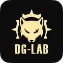

<div align="center">

<p>
  
  &nbsp;&nbsp;
  
</p>

<h1>星涟联动 · Coyote Link</h1>

在浏览器中控制郊狼 3。支持 A/B 双通道、波形编排、AI 控制、AI 上锁任务和情景演绎。

[**下载 Windows 免安装版**](https://github.com/qiu233333/coyote-link-studio/releases/latest) · [快速启动](#quick-start) · [第一次使用](#first-use) · [功能一览](#features) · [波形导入](#waveforms)
[**在线游玩**](https://coyote.qiu233.top:8443/)

</div>

<a id="quick-start"></a>

## 快速启动

### Windows 免安装版

1. 打开 [GitHub Releases](https://github.com/qiu233333/coyote-link-studio/releases/latest)，在 **Assets** 中下载文件名以 `-windows-x64.zip` 结尾的成品包。
2. 完整解压到可写目录，双击 `Start-Coyote.cmd`。
3. 等待「控制台与 AI 运行时已就绪」。浏览器会自动打开 [本机控制台](http://127.0.0.1:3000)。

支持 Windows 10/11 x64，包内已包含启动所需的运行时。升级时先停止旧版，备份整个 `data/`，再将其复制到新版解压目录。[安装、校验与数据迁移](docs/PORTABLE.md)

### 从源码运行

克隆仓库后，在项目目录运行以下命令。需要 Node.js 24+ 和 pnpm 11.5+。

```bash
pnpm install --frozen-lockfile
pnpm build
pnpm start
```

默认访问 [本机控制台](http://127.0.0.1:3000)。需要开发热更新时运行 `pnpm dev`。Windows 源码目录也可双击 `Start-Coyote.cmd`，由启动器按需安装和构建。[源码启动、端口与日志](docs/ENVIRONMENT.md)

<a id="first-use"></a>

## 第一次使用

1. **先用模拟设备试播。** 打开「控制台 → 连接管理」，选「模拟设备」并点击「建立连接」。在「实时控制」分别设置 A/B 的波形和目标强度，点击「开始播放」并确认。模拟模式不会连接实机，手动控制无需 API Key。
2. **连接郊狼 3。** 连接协议选 V4，用官方 APP 扫描配对二维码，再选择目标设备。V3 选项用于兼容旧版 APP。开始前核对两个通道各自的设备上限。V4 是 APP 联动协议，当前波形使用郊狼 3（`COYOTE_030`）的 V3 帧。
3. **按需配置 AI。** 打开「系统设置」，在「AI 服务」选择 DeepSeek 并填写自己的 API Key，或选择「自定义 OpenAI 兼容服务」，填写 Base URL、模型名和服务要求的 API Key。点击「保存并测试连接」，查看聊天和工具调用的测试结果。[DeepSeek 配置](docs/DEEPSEEK.md)

<a id="features"></a>

## 功能一览

| 工作区          | 可以做什么                                                                                                                         |
| --------------- | ---------------------------------------------------------------------------------------------------------------------------------- |
| **控制台**      | 实时调整 A/B 强度和波形，管理波形库、播放列表和阶段方案，在指定范围内随机播放，查看设备回传与运行记录。                            |
| **AI 控制**     | 设定通道、波形、各路强度范围、变化速率和会话时长，再让 AI 自主控制。运行中可反馈、暂停、修改范围、恢复或接管。                     |
| **AI 上锁任务** | 描述需求，生成并编辑任务草稿，确认后冻结任务版本、授权范围和最晚截止时间。锁定期间可查看、发送文字反馈或紧急停止。                 |
| **情景演绎**    | 创建或导入角色卡，以纯文字继续故事，也可授权 AI 随剧情调整设备。支持故事记忆、快捷回复和历史记录。[情景演绎指南](docs/ROLEPLAY.md) |
| **系统设置**    | 配置模型和密钥、测试接口，以及调整上下文窗口、决策和草稿超时。[AI 超时说明](docs/AI-TIMEOUTS.md)                                   |

A/B 分别使用设备上报的上限。列表、阶段、随机控制和 AI 范围都可分别设置两路强度。阶段编排和上锁任务草稿还提供独立的 A/B 全局倍率。

AI 上锁任务依据计时和用户文字反馈判断进度。任务结束、设备断线或不可恢复的故障都会结束当前运行。[AI 中断排查](docs/AI-INTERRUPTIONS.md)

<a id="waveforms"></a>

## 波形导入

在「控制台 → 波形库」选择或拖放文件，每次导入一个，最大 5 MB。导入成功后可以先预览，再选择通道或加入方案。

| 格式     | 支持内容                                                                                                       |
| -------- | -------------------------------------------------------------------------------------------------------------- |
| `.json`  | V3 原始帧数组、SDK 的 `label/raw` 格式、`name/frames` 格式及本项目导出的 JSON。                                |
| `.pulse` | 官方 APP 3.4.4 的 `Dungeonlab+pulse:` 明文文件。导入后转换为 V3 帧。[转换规则与兼容范围](docs/PULSE_FORMAT.md) |

**JSON 原始帧数组示例**

```json
["0A0A0A0A32323232", "1414141432323232"]
```

波形库按最终帧内容去重。波形预览显示相对幅度，实际输出由各通道的强度设置控制。运行中的任务使用启动时保存的波形内容。

<a id="faq"></a>

## 停止、后台与数据

- **停止设备输出**时，先使用网页上的「紧急停止」，核对 APP 或设备状态。如果显示「停止未确认」，请在 APP 或设备上检查输出。
- **退出后台**时，在确认设备停止后运行 `Stop-Coyote.cmd`。它会直接结束本项目进程。只关闭网页会保留后台调度，重启服务后需要手动开启新的运行。
- **备份时**保留整个 `data/`，包括数据库 `coyote.sqlite` 和用于解密 API Key 的 `installation.key`。数据目录可通过 `COYOTE_DATA_DIR` 指定。
- **网络与隐私**方面，网页服务默认只监听本机。在线 AI 会向配置的模型服务发送推理请求，使用官方中继连接 APP 需要网络。API Key 加密保存在本机后端。

<a id="development"></a>

## 开发与验证

前端使用 React、TypeScript 和 Vite，后台使用 Node.js 和 SQLite。设备联动通过 [郊狼 SDK](https://github.com/dungeonlab-open/dglab-kit)，AI 推理由 [eve](https://eve.dev/docs) 和 AI SDK 提供。

```bash
pnpm typecheck
pnpm test
pnpm build
```

专项验收包括 `pnpm verify:browser`、`pnpm verify:pulse-import` 和 `pnpm verify:roleplay`。自动化覆盖模拟设备与本地模型桩。[验证记录与实机验收范围](docs/VERIFICATION.md)

---

作者 **秋玌** · QQ 群 **828484276** · [素材来源](docs/ASSETS.md)
